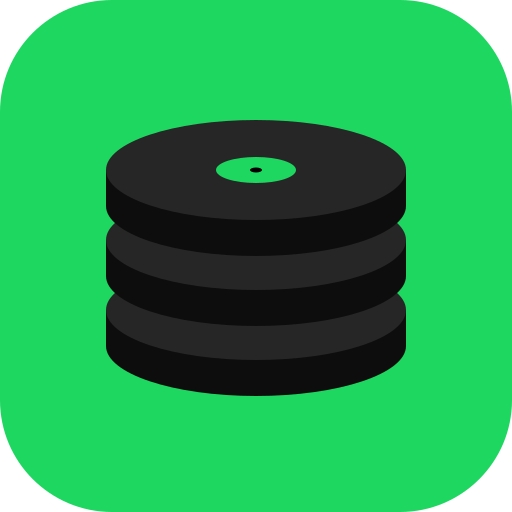
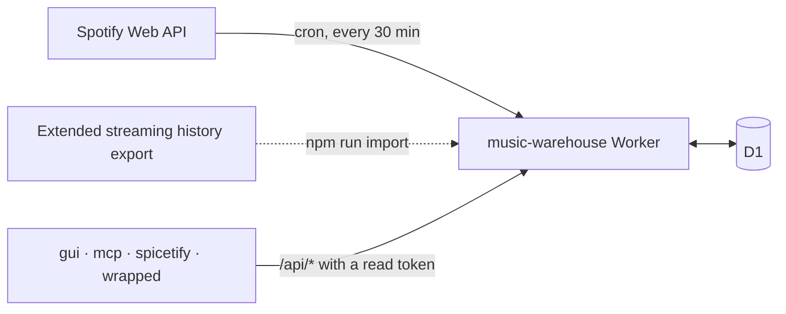

<div align="center">

<h1>music-warehouse</h1>
<p><strong>Your Spotify play history, recorded every 30 minutes into a database you own.</strong></p>
<p>
<a href="LICENSE"></a>

<a href="https://workers.cloudflare.com"></a>
<a href="https://github.com/rcnsh/music-warehouse#clients"></a>
</p>
<p><a href="#what-it-does">What it does</a> · <a href="#quick-start">Quick start</a> · <a href="#documentation">Documentation</a> · <a href="#clients">Clients</a></p>
</div>


A Cloudflare Worker that keeps your Spotify play history in a D1 database you
own, so it outlives Spotify's 50-play `recently-played` window. Every 30
minutes it polls Spotify and stores new plays; a bearer-authenticated JSON API
serves them back, along with stats, a year-in-review and per-artist history.
There is no UI; the [clients](#clients) are separate repos.

> [!NOTE]
> You need a Spotify account with **Premium** and a Cloudflare account (the
> free Workers and D1 plans are enough). See [Requirements](#requirements).

## What it does

- **Records every play.** A cron polls Spotify every 30 minutes and stores new
  plays in D1, with track, album, artist and the playlist or album they were
  played from.
- **Imports your past.** Spotify's Extended streaming history export fills in
  everything from before the Worker existed, and two scripts backfill album art.
- **Serves a JSON API.** Plays (also as CSV), search, daily counts, top artists
  and songs for any range, per-artist and per-song history, on-this-day, home
  screen rows, publishable stats and Wrapped-style summaries for any range.
- **Proxies live Spotify data.** Now playing, recently played and Spotify's top
  lists, so clients need no Spotify credentials of their own.
- **Finds concerts.** Optionally, with your own Ticketmaster key, a daily check
  for upcoming gigs by the artists you play most.
- **Serves synced lyrics.** Optionally, from the Spicy Lyrics API with your own
  secret key, so a client app needs no lyrics key of its own.
- **Looks after itself.** `/health` reports whether ingestion is working, each
  poll can push alerts to Discord, Slack or ntfy, and an optional heartbeat
  lets an outside monitor notice if the Worker stops altogether.
- **Hands out scoped tokens.** Per-device read or admin tokens, minted by the
  admin or by signing in with the Spotify account that owns the warehouse.

## How it fits together



The Worker is the only thing that talks to Spotify or the database. Clients
read the API with their own tokens.

## Clients

Each reads the [API](docs/api.md) with a read token, which it gets by
[signing in with Spotify](docs/setup.md#signing-in-with-spotify) or from a
pasted [device token](docs/setup.md#device-tokens). None of them stores or
polls anything itself.

| Repo | What it is |
|---|---|
| [music-warehouse-gui](https://github.com/rcnsh/music-warehouse-gui) | Native macOS app (Rust, GPUI): history, search, stats, artist and song pages |
| [music-warehouse-mcp](https://github.com/rcnsh/music-warehouse-mcp) | MCP server, so an AI agent can query your history |
| [music-warehouse-spicetify](https://github.com/rcnsh/music-warehouse-spicetify) | Spicetify custom app: stats inside the Spotify client |
| [music-warehouse-wrapped](https://github.com/rcnsh/music-warehouse-wrapped) | Wrapped-style stories in the browser, exportable as video |

## Requirements

- A Spotify account with **Premium**. A development-mode Spotify app only works
  for an owner with Premium; without it, only the export import works.
- A Cloudflare account. The free Workers and D1 plans are enough.
- Node.js 22 or later (Wrangler requires it). `.nvmrc` pins the version CI uses.

## Quick start

The short version. Each step links to the detail in
[docs/setup.md](docs/setup.md).

1. [Create a Spotify app](docs/setup.md#1-create-the-spotify-app) with redirect URIs
   `https://<your-worker-host>/callback` and `/auth/callback`, and request your
   Extended streaming history while you're there.
2. Clone, install and [configure](docs/setup.md#2-configure-the-deployment) your own copy
   of the `wrangler.jsonc` template:

   ```bash
   git clone https://github.com/rcnsh/music-warehouse && cd music-warehouse
   npm install
   npx wrangler login
   cp wrangler.jsonc wrangler.local.jsonc     # gitignored; your values go here
   ```

3. [Create the database](docs/setup.md#3-create-the-database), then
   [deploy and set secrets](docs/setup.md#4-deploy-and-set-secrets):

   ```bash
   npx wrangler d1 create music_warehouse     # copy the id into wrangler.local.jsonc
   npm run migrate:remote
   npm run deploy
   npx wrangler secret put SPOTIFY_CLIENT_ID
   npx wrangler secret put SPOTIFY_CLIENT_SECRET
   npx wrangler secret put ADMIN_TOKEN        # openssl rand -hex 32
   ```

4. [Authorize](#authorizing) ingestion and start the first poll:

   ```bash
   export WORKER_URL=https://music-warehouse.<you>.workers.dev
   export ADMIN_TOKEN=...
   npm run authorize -- --url "$WORKER_URL" --open
   curl -X POST -H "Authorization: Bearer $ADMIN_TOKEN" "$WORKER_URL/admin/poll"
   ```

5. Mint a [device token](docs/setup.md#device-tokens) for each client, and
   [import your history](docs/import.md) when the export arrives.

## Authorizing

Nothing is ingested until you approve Spotify's consent screen. `/login` needs
the admin token, so a script fetches the consent URL for you rather than you
opening `/login` in a browser:

```bash
export WORKER_URL=https://music-warehouse.<you>.workers.dev
export ADMIN_TOKEN=...                       # or: set -a && . ./.dev.vars && set +a
npm run authorize -- --url "$WORKER_URL" --open
```

| Flag | Default | |
|---|---|---|
| `--url` | `http://127.0.0.1:8787` | The Worker. |
| `--open` | off | Open the consent URL in your browser instead of only printing it. |
| `--waitSeconds` | `300` | How long to poll `/health` for the callback to land. |

Approve in the browser. Spotify redirects to `/callback`, which stores the
grant, and the script reports the new expiry. The consent URL is single-use and
expires after 10 minutes. Then start the first poll rather than waiting for the
cron:

```bash
curl -X POST -H "Authorization: Bearer $ADMIN_TOKEN" "$WORKER_URL/admin/poll"
```

### Re-authorizing

> [!IMPORTANT]
> Spotify expires the grant **six months after authorization**, and refreshing
> does not extend it. Put a reminder in your calendar, or set up
> [alerting](docs/operations.md#alerting).

When it lapses, polling stops, `/health` reports `needs_reauth` with an
`action_required` line, and the [alert](docs/operations.md#alerting) fires. `/health` also warns
from 14 days before. Run the same `npm run authorize` again; the six months
restart. Adding a scope to `SCOPE` in `src/spotify.ts` also needs a
re-authorization.

## Documentation

| | |
|---|---|
| [Setup](docs/setup.md) | Each setup step in full, device tokens, sign-in, every setting, crons and plan limits |
| [Importing your history](docs/import.md) | The Extended streaming history import and album-art backfills |
| [Optional features](docs/optional-features.md) | Concerts (Ticketmaster) and synced lyrics (Spicy Lyrics) |
| [API reference](docs/api.md) | Every route, its parameters, responses and errors; also as [OpenAPI](docs/openapi.yaml) |
| [Operations](docs/operations.md) | Health, alerting, heartbeat, redeploying, rollback, backups |
| [Design notes](docs/design.md) | How it works, why, and what it can't do |

## Development

```bash
cp .dev.vars.example .dev.vars          # fill it in
npm run migrate:local
npm run dev                             # http://127.0.0.1:8787
npm test                                # runs against a real local D1
npm run typecheck
```

To authorize locally, register `http://127.0.0.1:8787/callback` with Spotify
and run `npm run authorize` without `--url`. `npm audit` flags `sharp`, pulled
in by the test runner's `miniflare`; it never reaches the deployed Worker.

## Licence

MIT. See [LICENSE](LICENSE).

> [!WARNING]
> Spotify's Developer Terms prohibit using Spotify content to train machine
> learning models. A private listening warehouse is fine; feeding it to a model
> is not.
