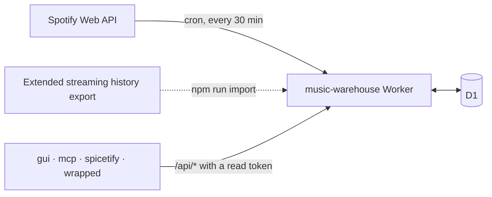

<div align="center">
<h1>music-warehouse</h1>
<p><strong>Your Spotify play history, recorded every 30 minutes into a database you own.</strong></p>
<p>
<a href="LICENSE"></a>

<a href="https://workers.cloudflare.com"></a>
<a href="https://github.com/rcnsh/music-warehouse#clients"></a>
</p>
<p><a href="#what-it-does">What it does</a> · <a href="#quick-start">Quick start</a> · <a href="#configuration">Configuration</a> · <a href="#api-reference">API reference</a> · <a href="#clients">Clients</a> · <a href="#related-projects">Related projects</a></p>
</div>

A Cloudflare Worker that keeps your Spotify play history in a D1 database you
own, so it outlives Spotify's 50-play `recently-played` window. Every 30
minutes it polls Spotify and stores new plays; a bearer-authenticated JSON API
serves them back, along with stats, a year-in-review and per-artist history.
There is no UI; the [clients](#clients) are separate repos.

> [!NOTE]
> You need a Spotify account with **Premium** and a Cloudflare account (the
> free Workers and D1 plans are enough). See [Requirements](#requirements).

## Contents

- [What it does](#what-it-does)
- [How it fits together](#how-it-fits-together)
- [Clients](#clients)
- [Requirements](#requirements)
- [Quick start](#quick-start)
- [Setting it up from scratch](#setting-it-up-from-scratch)
- [Authorizing](#authorizing)
- [Device tokens](#device-tokens)
- [Importing your history](#importing-your-history)
- [Configuration](#configuration)
- [API reference](#api-reference)
- [Operations](#operations)
- [Development](#development)
- [Design notes and limitations](docs/design.md)
- [Related projects](#related-projects)
- [Licence](#licence)

## What it does

- **Records every play.** A cron polls Spotify every 30 minutes and stores new
  plays in D1, with track, album, artist and the playlist or album they were
  played from.
- **Imports your past.** Spotify's Extended streaming history export fills in
  everything from before the Worker existed, and two scripts backfill album art.
- **Serves a JSON API.** Plays (also as CSV), search, daily counts, top artists
  and songs for any range, per-artist and per-song history, on-this-day, home
  screen rows, publishable stats and Wrapped-style summaries for any range.
- **Proxies live Spotify data.** Now playing, recently played and Spotify's top
  lists, so clients need no Spotify credentials of their own.
- **Finds concerts.** Optionally, a daily Ticketmaster check for upcoming gigs by
  the artists you play most.
- **Looks after itself.** `/health` reports whether ingestion is working, each
  poll can push alerts to Discord, Slack or ntfy, and an optional heartbeat
  lets an outside monitor notice if the Worker stops altogether.
- **Hands out scoped tokens.** Per-device read or admin tokens, minted by the
  admin or by signing in with the Spotify account that owns the warehouse.

## How it fits together



The Worker is the only thing that talks to Spotify or the database. Clients
read the API with their own tokens.

## Clients

Each reads the [API](#api-reference) with a read token, which it gets by
[signing in with Spotify](#signing-in-with-spotify) or from a pasted
[device token](#device-tokens). None of them stores or polls anything itself.

| Repo | What it is | Routes it reads |
|---|---|---|
| [music-warehouse-gui](https://github.com/rcnsh/music-warehouse-gui) | Native macOS app (Rust, GPUI): history, search, stats, artist and song pages | Nearly all of `/api/*` |
| [music-warehouse-mcp](https://github.com/rcnsh/music-warehouse-mcp) | MCP server, so an AI agent can query your history | Nearly all of `/api/*` |
| [music-warehouse-spicetify](https://github.com/rcnsh/music-warehouse-spicetify) | Spicetify custom app: stats inside the Spotify client | `/api/plays`, `/api/home`, `/api/stats/*`, `/api/top-*`, `/api/wrapped`, `/api/wrapped/ranges`, `/api/concerts`, `/api/track`, `/api/artist`, `/api/on-this-day` |
| [music-warehouse-wrapped](https://github.com/rcnsh/music-warehouse-wrapped) | Wrapped-style stories in the browser, exportable as video | `/api/wrapped`, `/api/wrapped/ranges`, `/api/top` |

Browser clients (Spicetify, Wrapped) need their origin in
[`CORS_ORIGINS`](#configuration). Changing a response shape here can break
them, so check this table first.

## Requirements

- A Spotify account with **Premium**. A development-mode Spotify app only works
  for an owner with Premium; without it, only the export import works.
- A Cloudflare account. The free Workers and D1 plans are enough.
- Node.js 22 or later (Wrangler requires it). `.nvmrc` pins the version CI uses.

## Quick start

The short version. Each step links to the detail.

1. [Create a Spotify app](#1-create-the-spotify-app) with redirect URIs
   `https://<your-worker-host>/callback` and `/auth/callback`, and request your
   Extended streaming history while you're there.
2. Clone, install and [configure](#2-configure-the-deployment) your own copy
   of the `wrangler.jsonc` template:

   ```bash
   git clone https://github.com/rcnsh/music-warehouse && cd music-warehouse
   npm install
   npx wrangler login
   cp wrangler.jsonc wrangler.local.jsonc     # gitignored; your values go here
   ```

3. [Create the database](#3-create-the-database), then
   [deploy and set secrets](#4-deploy-and-set-secrets):

   ```bash
   npx wrangler d1 create music_warehouse     # copy the id into wrangler.local.jsonc
   npm run migrate:remote
   npm run deploy
   npx wrangler secret put SPOTIFY_CLIENT_ID
   npx wrangler secret put SPOTIFY_CLIENT_SECRET
   npx wrangler secret put ADMIN_TOKEN        # openssl rand -hex 32
   ```

4. [Authorize](#authorizing) ingestion and start the first poll:

   ```bash
   export WORKER_URL=https://music-warehouse.<you>.workers.dev
   export ADMIN_TOKEN=...
   npm run authorize -- --url "$WORKER_URL" --open
   curl -X POST -H "Authorization: Bearer $ADMIN_TOKEN" "$WORKER_URL/admin/poll"
   ```

5. Mint a [device token](#device-tokens) for each client, and
   [import your history](#importing-your-history) when the export arrives.

## Setting it up from scratch

### 1. Create the Spotify app

1. At <https://developer.spotify.com/dashboard>, create an app with the Web API.
2. Add two redirect URIs: `https://<your-worker-host>/callback` for
   ingestion and `https://<your-worker-host>/auth/callback` for
   [signing in](#signing-in-with-spotify). Locally, also add the same two paths
   on `http://127.0.0.1:8787` (Spotify allows plain HTTP only on loopback).
3. Under **User Management**, add your own Spotify account (development mode
   allows five users).
4. Note the **client ID** and **client secret**.

> [!TIP]
> While you're there, request your **Extended streaming history** at
> <https://www.spotify.com/account/privacy/>. Not "Account data", which only
> covers a year. It can take up to 30 days to arrive, and it is the only way to
> get plays from before the Worker existed.

### 2. Configure the deployment

```bash
git clone https://github.com/rcnsh/music-warehouse && cd music-warehouse
npm install
npx wrangler login
cp wrangler.jsonc wrangler.local.jsonc
```

[`wrangler.jsonc`](wrangler.jsonc) is a template: its database id and redirect
URI are placeholders, so the repository holds nobody's deployment. Your own
values go in `wrangler.local.jsonc`, which is gitignored. `npm run dev`,
`npm run deploy`, `npm run migrate:*` and `npm run wrangler -- <command>` pass
it to Wrangler with `-c` whenever it exists
([`scripts/wrangler.mjs`](scripts/wrangler.mjs)); deploying without it is
refused. Run Wrangler through those scripts rather than bare `npx wrangler`
for anything that touches the database. When the template changes (a new
cron, a new binding), carry the change into your copy.

In `wrangler.local.jsonc`, set:

| | Key | Set it to |
|---|---|---|
| `[1]` | `database_id` | The id from the [next step](#3-create-the-database). |
| `[2]` | `vars.SPOTIFY_REDIRECT_URI` | The `/callback` redirect URI from step 1, exactly. |
| | `routes` | Optional: `[{ "pattern": "music.example.com", "custom_domain": true }]` for a custom domain. Without it the Worker is on `music-warehouse.<subdomain>.workers.dev`. |

The template also binds `AUTH_RATE_LIMITER`, a
[Workers Rate Limiting](https://developers.cloudflare.com/workers/runtime-apis/bindings/rate-limit/)
binding: 20 requests a minute per client address on the unauthenticated
`/auth/*` routes. Delete the `ratelimits` block to go without it; the cap on
pending sign-ins still holds.

Listening stats and Wrapped read local time in one timezone, `TIMEZONE`
(default UTC), and start at your first stored play. If you've lived in more
than one zone, set `ERAS` instead: a JSON list of periods, each with its own
timezone, for example

```json
[{ "key": "home", "label": "Home", "timeZone": "Europe/London", "from": "2020-07-01T00:00:00+01:00" },
 { "key": "abroad", "label": "Abroad", "timeZone": "Asia/Tokyo", "from": "2024-09-01T00:00:00Z" }]
```

`key` is lowercase letters, digits and `-`, and appears in stats responses;
`label` is for display. Every era after the first needs `from`. On the first,
`from` is optional and also marks where history starts, which helps if your
first few plays are noise. The `eras` stat compares the latest era with the
months before it. Set `ERAS` as a secret if an era's start is private: the
stats only publish the month. See [`src/eras.ts`](src/eras.ts). Ingestion and
the other routes don't depend on it.

### 3. Create the database

```bash
npx wrangler d1 create music_warehouse     # copy the id into wrangler.local.jsonc
npm run migrate:remote
npm run migrate:local                      # for wrangler dev and tests
```

### 4. Deploy and set secrets

```bash
npm run deploy
npx wrangler secret put SPOTIFY_CLIENT_ID
npx wrangler secret put SPOTIFY_CLIENT_SECRET
npx wrangler secret put ADMIN_TOKEN        # paste the output of: openssl rand -hex 32
```

The optional ones are in [Configuration](#configuration). For local work, copy
`.dev.vars.example` to `.dev.vars` and fill it in. It is gitignored; keep it at
mode 600.

### 5. Block unauthenticated traffic (recommended)

Every route but `/callback` and `/auth/*` needs a token, but unauthenticated
requests still reach the Worker. On the Free plan they count against its
100,000 requests a day, which the ingestion cron shares; on Workers Paid they
are only noise. A WAF custom rule (Security → WAF → Custom rules, action
**Block**) on your custom domain's zone stops them at the edge:

```txt
(http.host eq "your-host.example" and http.request.uri.path ne "/callback" and not starts_with(http.request.uri.path, "/auth/") and http.request.method ne "OPTIONS" and not len(http.request.headers["authorization"][0]) > 0)
```

`/callback` stays open for Spotify's redirect, which its single-use `state`
guards. `/auth/*` stays open for [signing in](#signing-in-with-spotify), which
is how a device without a token gets one. The `AUTH_RATE_LIMITER` binding
limits it per client inside the Worker; a WAF rate-limiting rule on `/auth/`
stops a flood before it reaches the Worker at all, and is a sensible extra. `OPTIONS` stays open for browser clients' CORS preflights,
which never carry the header; drop that clause if you don't set `CORS_ORIGINS`.

Then [authorize](#authorizing).

## Authorizing

Nothing is ingested until you approve Spotify's consent screen. `/login` needs
the admin token, so a script fetches the consent URL for you rather than you
opening `/login` in a browser:

```bash
export WORKER_URL=https://music-warehouse.<you>.workers.dev
export ADMIN_TOKEN=...                       # or: set -a && . ./.dev.vars && set +a
npm run authorize -- --url "$WORKER_URL" --open
```

| Flag | Default | |
|---|---|---|
| `--url` | `http://127.0.0.1:8787` | The Worker. |
| `--open` | off | Open the consent URL in your browser instead of only printing it. |
| `--waitSeconds` | `300` | How long to poll `/health` for the callback to land. |

Approve in the browser. Spotify redirects to `/callback`, which stores the
grant, and the script reports the new expiry. The consent URL is single-use and
expires after 10 minutes. Then start the first poll rather than waiting for the
cron:

```bash
curl -X POST -H "Authorization: Bearer $ADMIN_TOKEN" "$WORKER_URL/admin/poll"
```

### Re-authorizing

> [!IMPORTANT]
> Spotify expires the grant **six months after authorization**, and refreshing
> does not extend it. Put a reminder in your calendar, or set up
> [alerting](#alerting).

When it lapses, polling stops, `/health` reports `needs_reauth` with an
`action_required` line, and the [alert](#alerting) fires. `/health` also warns
from 14 days before. Run the same `npm run authorize` again; the six months
restart. Adding a scope to `SCOPE` in `src/spotify.ts` also needs a
re-authorization.

## Device tokens

Give each device or client its own token rather than copying `ADMIN_TOKEN`
around. A lost phone then costs one revocation, and a client that only reads
never holds a credential that can write.

```bash
curl -X POST -H "Authorization: Bearer $ADMIN_TOKEN" -H 'Content-Type: application/json' \
  -d '{"name": "iPhone Wrapped"}' "$WORKER_URL/admin/tokens"
```

The response holds the token, `mw_` and 43 characters. It is shown **once**;
only a hash is stored.

| Field | Default | |
|---|---|---|
| `name` | required | 1 to 64 characters, to recognise it in the list. |
| `access` | `read` | `read` reaches `/api/*`; `admin` reaches everything. |
| `expires_in_days` | `90` | 1 to 3660, or `null` for a token that never expires. |

`GET /admin/tokens` lists them with when each was last used (to the hour), and
`DELETE /admin/tokens?id=tok_…` revokes one immediately. Revoked tokens stay
in the list.

Keep `ADMIN_TOKEN` in a password manager as the way back in if every device
token is lost.

`READ_TOKEN` is deprecated: one shared secret that never expires and cannot be
revoked for one reader without breaking the rest. It still works, and every
use logs a `read-token-deprecated` warning (see `npx wrangler tail`), so
you can find what still sends it. Move each of those to a device token, and
once the warning stops, delete it with `npx wrangler secret delete READ_TOKEN`.
Don't set it on a new deployment.

### Signing in with Spotify

A device can also get a **read** token by signing in with the Spotify account
that owns the warehouse (the one that [authorized](#authorizing) ingestion).
Any other Spotify account is refused. Sign-in never mints admin tokens, and it
never touches the ingestion grant: it asks Spotify for no scopes and discards
what Spotify returns once it has read the account id. Tokens it mints expire
after 90 days and show `created_via: "spotify"` in the list.

Every sign-in starts on a warehouse page that names the device and where its
token will go, with **Allow** and **Cancel**. Only Allow goes on to Spotify,
and Spotify then shows its own consent dialog every time, even for an account
that approved the app before. Both steps happen in the browser, and Spotify
must send it back to the same browser that pressed Allow (a cookie checks it).
That matters because PKCE only proves the code reaches whoever *started* the
sign-in: any program on the machine can listen on `127.0.0.1`, and any mobile
app can register a URL scheme. So read the page, and press Allow only for a
sign-in you started.

Sign-ins in progress are capped at 10 per client address (its /64 for IPv6;
only a keyed hash of it is stored) and 200 overall, for up to 10 minutes each.
Past either, `/auth/login` answers `429`.

**In a browser, for a shell or script:** open
`$WORKER_URL/auth/login?name=laptop`, press Allow, approve at Spotify, and
copy the token from the page. It is shown once.

**From an app**, it works like OAuth with PKCE
([RFC 7636](https://www.rfc-editor.org/rfc/rfc7636)). `return_to` can be:

| Kind | `return_to` | Exchange |
|---|---|---|
| Web app | A URL on an origin listed in `CORS_ORIGINS` | From that origin, in the browser. |
| Desktop app or CLI | `http://127.0.0.1:<any port>/…` or `http://[::1]:<any port>/…`, where the app listens | From the app; no `Origin`. |
| Mobile app | `<scheme>://…`, with the scheme listed in `SIGN_IN_SCHEMES` | From the app; no `Origin`. |

`localhost` is refused; use the IP literal
([RFC 8252](https://www.rfc-editor.org/rfc/rfc8252#section-8.3)).

1. Generate a random `code_verifier` (43 to 128 characters of
   `A-Z a-z 0-9 - . _ ~`) and keep it, e.g. in `sessionStorage`.
   `code_challenge` is base64url(SHA-256(verifier)), without padding.
2. Send the browser to
   `/auth/login?name=<device>&return_to=<url on your origin>&code_challenge=<challenge>`.
   It shows the confirmation page; the owner presses Allow and approves at
   Spotify.
3. The browser comes back to `return_to` with `?code=…`, or with `?error=`:
   `access_denied` (Cancel, a refusal at Spotify, or a sign-in finished in
   another browser), `not_owner` or `unavailable`.
4. Within 60 seconds, `POST /auth/token` with
   `{ "code": "…", "code_verifier": "…" }`. The response is the minted token,
   as from `POST /admin/tokens`.

A code works once, even if the exchange fails, and only alongside the verifier
that produced its challenge. A failed exchange always answers
`400 { "error": "invalid_grant" }`.

A warehouse authorized before sign-in existed learns its owner's account id on
the first sign-in, from the stored grant.

## Importing your history

All the scripts below read `ADMIN_TOKEN` from the environment, as
`npm run authorize` does.

### The export

Unzip the export. The script reads every `Streaming_History_Audio_*.json` in
one directory:

```bash
unzip my_spotify_data.zip -d export
npm run import -- --dir "export/Spotify Extended Streaming History" --url "$WORKER_URL"
```

| Flag | Default | |
|---|---|---|
| `--dir` | `./export-data` | Directory holding `Streaming_History_Audio_*.json`. |
| `--url` | `http://127.0.0.1:8787` | The Worker. |
| `--chunk` | `500` | Records per `POST /admin/import`. |
| `--dailyRowLimit` | `90000` | Stop after writing this many rows in a UTC day. |
| `--state` | `.import-state.json` | Where progress is saved. |
| `--delayMs` | `250` | Pause between chunks. |
| `--matchWindow` | `5` | Seconds within which an export record and a stored play of the same track count as one play. `0` matches exact timestamps only. |
| `--dryRun` | off | Write nothing; report where the export would add plays. |
| `--tz` | this machine's zone | Zone for the dry run's months and days. |
| `--report` | `import-report.json` | Where the dry run writes per-day counts. |

On the Free plan D1 allows 100,000 row writes a day, index writes included, so
the script stops at 90,000 and a long history takes several days. Re-run it
after 00:00 UTC and it continues from `.import-state.json`. Workers Paid has no
daily cap (50 million writes a month are included), so there pass a larger
`--dailyRowLimit` to import in one run. Re-running is always safe: a record
is ignored when a play of the same track is already stored within 5 seconds
of it, which also catches the poller's copy of the same play (the export
rounds times down to the second, the API keeps milliseconds). Skips, records
with `ms_played` under 30 seconds, are dropped, as are podcasts and local
files. An import clears the cached stats and Wrapped bodies, which recompute
on their next request.

Histories imported before skips were dropped can be cleaned with
`npm run clean:export`. It reports by default; `--apply` removes:

```bash
npm run clean:export -- skips --dir "export/Spotify Extended Streaming History" --url "$WORKER_URL"
npm run clean:export -- short-gaps --url "$WORKER_URL"   # without the files: a heuristic
npm run clean:export -- overlaps --url "$WORKER_URL"     # export copies of polled plays
```

`skips` is exact: the files name each skip. `short-gaps` removes export plays
that ended under 30 seconds after the play before, which never removes a play
that counted but misses a skip that followed a pause. Every removal repairs the
rollup and play numbers and clears the cached bodies.


#### Finding gaps first

A dry run walks the whole export, writes nothing (no plays, no progress, no row
budget) and prints how many plays each month would gain, with per-day counts in
`import-report.json`:

```bash
npm run import -- --dryRun --dir "export/Spotify Extended Streaming History" --url "$WORKER_URL"
```

It also prints how far apart matched stored and export timestamps were. The
same play should land at a steady offset well inside the 5-second window
(`--matchWindow`). If many new plays fall in months the poller already covered,
compare with a dry run at a wider `--matchWindow` before the real run; two
genuine plays of a track end at least 30 seconds apart, so keep it under that.

### Album art

The export names albums but carries no art. Two scripts fill it in, both
resumable and safe to interrupt:

```bash
npm run backfill:albums -- --url "$WORKER_URL"    # most of it, in minutes
npm run backfill:catalog -- --url "$WORKER_URL"   # the rest, ~600 tracks a day
```

`backfill:albums` walks your Top Tracks, Liked Songs and Saved Albums:

| Flag | Default | |
|---|---|---|
| `--source` | `all` | `top`, `saved`, `albums`, or `all` for all three. |
| `--pages` | `4` | Pages of 50 per request (1 to 20). |
| `--state` | `.albums-state.json` | |
| `--delayMs` / `--maxRetries` | `300` / `5` | |

`backfill:catalog` looks tracks up one at a time, which reaches the ones you
never saved. Spotify allows a development-mode app roughly 600 of these a day;
the script stops at the first 429, prints when to try again, and resumes from
`.catalog-state.json`.

| Flag | Default | |
|---|---|---|
| `--limit` | `25` | Tracks per request (1 to 200). |
| `--state` | `.catalog-state.json` | |
| `--delayMs` / `--maxRetries` | `2000` / `6` | |

Both also take `--url` (default `http://127.0.0.1:8787`).

## Configuration

Secrets are set with `npx wrangler secret put <NAME>`, or in `.dev.vars`
locally. `npx wrangler secret list` shows what is set.

| Name | Required | |
|---|---|---|
| `SPOTIFY_CLIENT_ID` | yes | From the Spotify dashboard. |
| `SPOTIFY_CLIENT_SECRET` | yes | From the Spotify dashboard. |
| `ADMIN_TOKEN` | yes | Full access. `openssl rand -hex 32`. Keep it offline and use [device tokens](#device-tokens) day to day. |
| `SPOTIFY_REDIRECT_URI` | yes | A var in `wrangler.jsonc`, not a secret. `.dev.vars` overrides it locally. |
| `READ_TOKEN` | no | Deprecated: `/api/*` only. Prefer a read [device token](#device-tokens). |
| `CONTROL_TOKEN` | no | [`POST /control/play`](#playback-control) only, for the one client allowed to start playback. `openssl rand -hex 32`. |
| `CORS_ORIGINS` | no | Comma-separated browser origins (or `*`) allowed to call `/api/*`, e.g. `https://wrapped.example.com`. Unset sends no CORS headers. |
| `ALERT_WEBHOOK_URL` | no | Where alerts are POSTed. See [Alerting](#alerting). |
| `ALERT_MENTION` | no | Prefix for every alert, e.g. a Discord `<@id>`. |
| `HEARTBEAT_URL` | no | A dead-man's switch, e.g. a [healthchecks.io](https://healthchecks.io) ping URL, fetched after every successful poll. See [Heartbeat](#heartbeat). |
| `SIGN_IN_SCHEMES` | no | Comma-separated custom URL schemes a mobile app may [sign in](#signing-in-with-spotify) to, e.g. `app.remastered`. |
| `TICKETMASTER_API_KEY` | no | A Ticketmaster Discovery API consumer key, from <https://developer.ticketmaster.com>, for [concerts](#concerts). The consumer secret isn't needed. Unset turns the concert check off. |
| `TIMEZONE` | no | IANA timezone the stats read local time in, when `ERAS` is unset. Default `UTC`. Also the zone of the [play-count rollup](#the-play-count-rollup); with only `ERAS` set, the rollup uses the latest era's zone. |
| `ERAS` | no | JSON list of periods, each read in its own timezone. See [step 2](#2-configure-the-deployment) and [`src/eras.ts`](src/eras.ts). |
| `CONCERT_REGIONS` | no | JSON list of places to look for [concerts](#concerts). Unset means none. |

### Crons

The crons are in `wrangler.jsonc`:

| Schedule (UTC) | Does |
|---|---|
| `*/30 * * * *` | Polls Spotify for new plays, exactly as `POST /admin/poll` does, then pings the [heartbeat](#heartbeat) if the poll succeeded and runs the [alert](#alerting) check. |
| `0 9 * * *` | The daily artist reconcile, search index and song sync; brings the [play-count rollup](#the-play-count-rollup) up to date; computes one Wrapped preset. |
| `23 1 * * *` | The [concert](#concerts) check, in its own invocation so it gets a full subrequest budget. |

Polling every 30 minutes is 48 requests a day; tighten it to `*/15` if plays
ever go missing.

### Plan and limits

This deployment runs on Workers Paid. There D1 meters reads and writes against
a monthly allowance (25 billion rows read and 50 million written, then billed
per million) and never stops answering. On the Free plan D1 stops answering
for the rest of the UTC day, ingestion included, once 5 million rows have been
read or 100,000 written. The Worker still runs on Free: stats are cached so
their cost doesn't grow with traffic, and the concert check fits Free's 50
subrequests. Every route that reads stored plays reports the D1 rows it read
in an `X-Rows-Read` header; `/api/plays`, `/api/daily` and `/api/top-artists`
also put it in the body's `_meta.rows_read`.

`/api/artist`, `/api/track`, `/api/top-artists`, `/api/top-tracks`,
`/api/daily` and `/api/on-this-day` are kept in the Cache API until a new
play or track arrives (three rows read to check), and sent with
`Cache-Control: private, max-age=60`; a kept answer has `X-Cache: hit`, and its
`X-Rows-Read` is the rows the check read, while the body's `_meta.rows_read`
stays what its first computation read. A fresh answer's header matches `_meta`. An import of older plays can
take up to ten minutes to show there. `/api/now-playing` and
`/api/recently-played` share one Spotify answer across every client and colo;
see [Live from Spotify](#live-from-spotify).

### The play-count rollup

`/api/daily`, `/api/top-tracks` and `/api/top-artists` over long ranges read
counts per local day, and per local month and track, from tables that
triggers on `plays` keep up to date (migration 0014), instead of every play.
A year of `/api/daily` reads about 370 rows instead of 15k; a year of top
tracks about 19k instead of 42k. The answers are identical either way.

The rollup is built in one zone: `TIMEZONE`, else the latest era's zone, else
UTC. A request whose `tz` is that zone uses it; any other `tz` counts plays as
before. The migration builds it in UTC. For any other zone it is rebuilt by
the daily cron, or at once with `POST /admin/rollup` (about 600k rows read and
18k written for 76k plays, once). Changing `TIMEZONE` or `ERAS` later rebuilds
it the same way.

## API reference

> [!TIP]
> The read API is also described as an OpenAPI 3.1 spec in
> [`docs/openapi.yaml`](docs/openapi.yaml). Clients can generate types from it,
> e.g. `npx openapi-typescript docs/openapi.yaml -o api.d.ts`. Its
> `info.version` goes up with every change to a response's shape.

Every route except `/callback` and `/auth/*` takes `Authorization: Bearer <token>`.

| Token | Reaches |
|---|---|
| `ADMIN_TOKEN`, or an `admin` [device token](#device-tokens) | Everything. |
| A `read` device token, or `READ_TOKEN` | `/api/*` only. Wrapped: presets and ranges already computed. |
| `CONTROL_TOKEN` | [`POST /control/play`](#playback-control) only. Not a device token: it reads nothing. |

Responses are JSON. Errors are `{ "error": "..." }` with:

| Status | Meaning |
|---|---|
| `400` | A bad parameter; the message says which. |
| `401` | Missing or wrong token, or a read token on a route outside `/api/*`. |
| `403` | A read token asked Wrapped for a range it may not compute. |
| `404` | `Not found`: no such route. |
| `429` | Spotify rate limit or quota (live routes), `Too many sign-ins in progress` from `/auth/login`, or `Too many sign-in requests` from any `/auth/*` route when `AUTH_RATE_LIMITER` is bound. |
| `500` | `Worker misconfigured: …` when a setting such as `ERAS` or `CONCERT_REGIONS` is malformed (the message names the setting, never its value); otherwise `Internal error`. |
| `502` | Any other Spotify failure (live routes). |
| `503` | Either a stat or Wrapped range is still being computed, or (live routes only) the Spotify grant has lapsed. See below. |

Spotify failures (`429`, `502`) also carry `retry_after_seconds` when Spotify
gave one.

The two `503`s need different handling:

| | Still computing | Grant lapsed |
|---|---|---|
| Routes | `/api/stats/*`, `/api/wrapped` | `/api/now-playing`, `/api/recently-played`, `/api/top` |
| Headers | `Retry-After: <seconds>` | none |
| Body | `{ "error": "..." }` | `{ "error": "Spotify connection needs re-authorization.", "needs_reauth": true }` |
| What to do | Retry after `Retry-After` seconds. | Don't retry: the owner must [re-authorize](#authorizing). Stored-data routes keep working. |

Tell them apart by `needs_reauth` in the body (or a `Retry-After` header).

Dates are `YYYY-MM-DD` local calendar days; a date that doesn't exist
(`2026-02-30`) is a `400`. `tz` is an IANA zone, by default the warehouse's
own: `TIMEZONE`, else the latest era's zone, else `UTC` (the response's `tz`
says which). Ranges are inclusive and at most 3,660 local calendar days.
Timestamps in responses are UTC.

### Endpoints at a glance

| Method | Path | Purpose |
|---|---|---|
| `GET` | [`/api/plays`](#stored-plays) | Stored plays, newest first, with filters and paging. |
| `GET` | [`/api/plays.csv`](#stored-plays) | The same plays as one CSV download. |
| `GET` | [`/api/top-artists`](#stored-plays) | Play counts per artist over a date range. |
| `GET` | [`/api/top-tracks`](#stored-plays) | Play counts per song over a date range. |
| `GET` | [`/api/daily`](#stored-plays) | Plays per local day, week or month, optionally for one song or artist. |
| `GET` | [`/api/artist`](#history) | One artist's whole history. |
| `GET` | [`/api/track`](#history) | One song's whole history, editions folded. |
| `GET` | [`/api/on-this-day`](#history) | Top songs on this date in earlier years. |
| `GET` | [`/api/home`](#home) | Home-screen rows ranked from the history. |
| `GET` | [`/api/search`](#search) | Stored artists and songs by name. |
| `GET` | [`/api/stats/{name}`](#stats) | Cached aggregates safe to publish. |
| `GET` | [`/api/wrapped`](#wrapped) | A Wrapped-style summary of any finished range. |
| `GET` | [`/api/wrapped/ranges`](#wrapped) | The Wrapped presets. |
| `GET` | [`/api/concerts`](#concerts) | Upcoming Ticketmaster events for your top artists. |
| `GET` | [`/api/now-playing`](#live-from-spotify) | Spotify's currently-playing, live. |
| `GET` | [`/api/recently-played`](#live-from-spotify) | Spotify's recently-played, live. |
| `GET` | [`/api/top`](#live-from-spotify) | Spotify's top tracks and artists, live. |
| `POST` | [`/control/play`](#playback-control) | Start a track on the active Spotify device. |
| | [`/login`, `/callback`, `/auth/*`](#sign-in-and-authorization) | Authorizing ingestion and signing in. |
| | [`/health`, `/admin/*`](#admin) | Health, polling, imports, tokens and maintenance. Admin only. |

### Stored plays

These read only D1, so they keep working when the Spotify grant has lapsed.

**`GET /api/plays`**: plays, newest first, with track, album and artist names.

| Param | Default | |
|---|---|---|
| `limit` | `50` | 1 to 500. |
| `before` | none | The previous page's `next_before`, to page; or an epoch-ms, for plays strictly before that millisecond. |
| `after` | none | Only plays after this epoch-ms. |
| `q` | none | Only plays whose track, album or any artist name contains this, ignoring case and accents (at most 200 characters). Pages with `before` like the unfiltered list, and the response echoes `q`. |
| `track_id` | none | Only plays of this song: every edition, folded as `/api/track` folds them (same title less any remaster, "single version" or "radio edit" tag, and same primary artist). Any edition's id works. |
| `artist_id` | none | Only plays credited to this artist as `/api/artist` credits them: primary artist only, export `name:` placeholders with the same name included. |
| `artist_name` | none | The artist by name, as `/api/artist`'s `name`: a fallback for an artist the warehouse has no id for (`/api/search` gives `id: null`). |

To page, pass each response's `next_before` back as `before` (URL-encoded)
until it is `null`. It is an opaque cursor that resumes after exactly the last
play returned, ordered by time and then track id, so plays sharing a
millisecond (about 1.7k in imported history) are neither skipped nor repeated.
Passing the last `played_at_ms` still works, but skips any plays that share
its millisecond and didn't fit on the page.

The filters combine (each narrows the last) and work with `before`, `after`
and `limit`. Each one given is echoed at the top level of the response, as
`q` is:

```json
GET /api/plays?artist_id=4NJhFmfw43RLBLjQvxDuRS&q=shelter&limit=1
{ "q": "shelter", "artist_id": "4NJhFmfw43RLBLjQvxDuRS",
  "plays": [ { "played_at_ms": 1760521802000, "track_id": "…", "track_name": "Shelter", "…": "…" } ],
  "next_before": "1760521802000.4cOdK2wGLETKBW3PvgPWqT",
  "_meta": { "rows_read": 1507, "duration_ms": 18.4 } }
```

`track_id` and `artist_id` read about one row per track they resolve to
(about 100 for an artist with 93 tracks), plus about one per play of the song
or artist to fill a page: they sort that song's or artist's plays rather than
walking everyone's.

```json
{ "plays": [ { "played_at_ms": 1760521802000, "track_id": "…", "track_name": "Shelter",
               "artists": "Porter Robinson, Madeon", "album_name": "Shelter", "image_url": "https://i.scdn.co/…",
               "duration_ms": 219000, "isrc": "…", "context_uri": "spotify:playlist:…", "context_type": "playlist",
               "context_name": "Morning Mix", "source": "api", "play_number": 96, "first_play": false,
               "artist_list": [ { "id": "3dz0NnIZhtKKeXZxLOxCam", "name": "Porter Robinson" },
                                { "id": "5LhTec3c7dcqBvpLRWbMcf", "name": "Madeon" } ] } ],
  "next_before": "1760521802000.4cOdK2wGLETKBW3PvgPWqT",
  "_meta": { "rows_read": 50, "duration_ms": 1.2 } }
```

<details>
<summary>Field notes: <code>artist_list</code>, <code>source</code>, <code>context_name</code>, <code>play_number</code>, and the cost of <code>q</code></summary>

`artist_list` holds every credited artist in credit order, each with its id,
so a client can link them without splitting `artists` (which is the same
names joined with `, `, and so can't tell "Tyler, The Creator" from two
artists). An id may be an imported play's `name:` placeholder, which
`/api/artist?id=` accepts. A track with no stored credits has
`"artists": null` and `"artist_list": []`. Both come from the same read of
the credits, so they cost no more than `artists` did alone.

`source` is `api` for polled plays and `export` for imported ones.

`context_name` is the name of the album, artist or playlist the play was
started from, or `null` when there was none or it isn't known (yet). Albums
and artists are named from the warehouse's own tables. Everything else is
asked of Spotify by the poll, three a poll, so a backlog drains over a few
polls; a playlist name is refreshed weekly. Spotify refuses third-party apps
many editorial and algorithmic playlists ("Discover Weekly", "Daily Mix"):
those stay `null` and are asked again every 30 days, as do private playlists
if the grant lacks `playlist-read-private` (the Worker doesn't ask for it).
Migration 0013 lists every context already stored. Export plays carry no
context.

`play_number` says which play of its song this was, counting every edition
the way `/api/track` folds them (same title and primary artist, ignoring
ASCII case), and `first_play` is `true` for a song's first ever play. Both are
`null` for a play that has no row in that table, such as one with no stored
track. They come from a table kept up to date by every poll and import
(migration 0012), so they cost one row read per play; an import of older plays renumbers the later plays of each song it
touches. A track whose title or primary artist changes (the daily artist
reconcile can do this) moves to its new song by the next daily sweep.

With `q`, matching names reads about one row per matching track, from a
trigram index (migration 0011), plus the plays read to fill the page. One- and
two-character queries can't use the index and scan the name tables instead,
about 11k rows, matching case-insensitively for ASCII only. The matching
track ids are cached at the edge for five minutes per query, so the pages
after the first skip that step (one row read instead). A track stored since
then shows up at once; a renamed one can take those five minutes.

</details>

**`GET /api/plays.csv`**: the same plays as one CSV download, newest first,
for a spreadsheet or a backup. Takes `/api/plays`' filters (`q`, `track_id`,
`artist_id`, `artist_name`, `before` as an epoch-ms or a `next_before` cursor,
`after`) and a local-date range: `from`
and `to` with `tz`, as `/api/daily` takes them. Give neither for the whole
history; with only one, the other takes `/api/daily`'s default. No `limit`:
it streams every matching play, 10,000 per D1 query, so the Worker holds one
page at a time, and looks up each track's names once per download. At most
two queries per page means the Workers Paid plan (1,000 queries a request)
reaches five million plays, the Free plan (50) about 240,000.

```csv
played_at,track,artists,album,track_id,context_uri,context_name,source
2026-10-15T09:50:02.000Z,Shelter,"Porter Robinson, Madeon",Shelter,4cOdK2wGLETKBW3PvgPWqT,spotify:playlist:…,"Mix, Vol. 1",api
```

Quoting follows RFC 4180 and lines end in CRLF. `played_at` is UTC; `artists`
lists every credited artist. A bad parameter is a `400` before anything
streams. It reads about seven rows per play (the joins to names), so a whole
history of 76k plays is about 680k rows.

**`GET /api/top-artists`**: play counts per artist, every credited artist on
a track getting the play. Artists are grouped by name, ignoring case, so an
export placeholder (`name:` id) counts with the real artist; `artist_id` is
the real id where one is known. Params: `from` (default 29 days ago), `to`
(default today), `tz`, `limit` (1 to 500, default 50).

```json
GET /api/top-artists?from=2026-10-01&to=2026-10-14&tz=Europe/London&limit=1
{ "from": "2026-10-01", "to": "2026-10-14", "tz": "Europe/London",
  "artists": [ { "artist_id": "3dz0NnIZhtKKeXZxLOxCam", "name": "Porter Robinson", "plays": 41 } ],
  "_meta": { "rows_read": 1212, "duration_ms": 3.4 } }
```

**`GET /api/top-tracks`**: play counts per song, editions folded (same title,
less a remaster, "single version" or "radio edit" tag, and same primary
artist). Same params as `/api/top-artists`. Returns
`{ from, to, tz, tracks: [{ id, name, artist, plays, image }] }`; `id` is the
most-played edition's. It has no `_meta`: the rows it read are in the
`X-Rows-Read` header.

**`GET /api/daily`**: plays per local day, quiet days as `0`. Params: `from`,
`to`, `tz`, as above, and `track_id`, `artist_id` and `artist_name` as on
`/api/plays`, for one song's or one artist's daily chart. A filter given is
echoed. `group_by=week` sums the days into `weeks` (`{ week, plays }`, local
weeks from Monday, each labelled with its Monday, which may fall before
`from`) and `group_by=month` into `months` (`{ month: "YYYY-MM", plays }`);
either replaces `days` and echoes `group_by`. The default, `day`, leaves the
body as below. Filtered, it reads about one row per play of that song or artist in
the range rather than one per play of anything (a year of one artist: 1.9k
rows rather than 15k).

```json
GET /api/daily?from=2026-10-01&to=2026-10-02&tz=Europe/London&track_id=…
{ "from": "2026-10-01", "to": "2026-10-02", "tz": "Europe/London", "track_id": "…",
  "days": [ { "day": "2026-10-01", "plays": 3 }, { "day": "2026-10-02", "plays": 0 } ],
  "_meta": { "rows_read": 214, "duration_ms": 1.1 } }
```

### History

**`GET /api/artist?id=&name=&tz=`**: one artist's whole history. Give `id`, `name`
or both; `name` catches plays imported from the export.

**`GET /api/track?id=&tz=`**: the same for one song, all editions folded together.

**`GET /api/on-this-day?date=&tz=`**: the top songs on this date in each
earlier year. `date` defaults to today in `tz`.

```json
GET /api/artist?id=4NJhFmfw43RLBLjQvxDuRS&tz=Europe/London
{ "artist": { "id": "4NJhFmfw43RLBLjQvxDuRS", "name": "Porter Robinson" },
  "plays": 812, "minutes": 2410,
  "first_played": "2020-07-03T21:14:02.000Z", "last_played": "2026-10-12T13:40:11.000Z",
  "months": [ { "month": "2020-07", "plays": 14 } ],
  "top_tracks": [ { "id": "…", "name": "Shelter", "plays": 96, "image": "https://i.scdn.co/…" } ] }

GET /api/on-this-day?date=2026-10-13&tz=Europe/London
{ "date": "2026-10-13",
  "years": [ { "year": 2025, "plays": 41,
               "top_tracks": [ { "id": "…", "name": "…", "artist": "…", "image": "…", "plays": 6 } ] } ] }
```

An unknown artist or song is a `200` with zero plays and `null` dates, never a
`404`. `minutes` is an estimate (see [design notes](docs/design.md#wrapped)).

### Home

**`GET /api/home?tz=`**: the rows of a client's home screen, ranked from the
whole history: `shortcuts` (played most, lately and at this time of day),
`jump_back_in` (newest first), `around_now` (what you play at this hour) and
`rediscover` (played on many days, but not in the last 90). Each item is a
playlist, album or artist; plays with no context count toward their track's
album, and Liked Songs toward nothing. Rows can overlap: show each item once,
in this order. How it ranks: [design notes](docs/design.md#home).

```json
GET /api/home?tz=Europe/London
{ "tz": "Europe/London", "hour": 20,
  "shortcuts": [ { "uri": "spotify:album:…", "type": "album", "name": "…", "image": "https://i.scdn.co/…",
                   "artist": "…", "sessions": 14, "last_played_ms": 1760554020000 } ],
  "jump_back_in": [], "around_now": [], "rediscover": [] }
```

`name` and `image` are `null` when the warehouse doesn't know them (playlists
and artists have no image here, and some playlists no name), so a client looks
those up itself. `artist` is an album's or artist page's primary artist.
`sessions` is how many times it was played from (for `rediscover`, on how many
days).

### Search

**`GET /api/search?q=&artist=&limit=`**: stored artists and songs whose name
contains `q`, case-insensitively, to find the `id` or `name` the history
routes take. `artist` narrows songs to a primary artist whose name contains
it. `limit` is 1 to 50 per list, default 10. Exact matches come first, then
the most played.

```json
GET /api/search?q=shelter
{ "q": "shelter",
  "artists": [],
  "tracks": [ { "id": "…", "name": "Shelter", "artist": "Porter Robinson", "plays": 96 } ] }
```

Results fold as the history routes do: an artist's plays from the export join
the real id (`id` is `null` when only the export knows the artist, so pass the
`name` to `/api/artist`), and a song's editions count once. `plays` credits
the primary artist only. Matching is ASCII-case-insensitive, as SQLite's is.

Queries of three or more characters take their candidates from the trigram
index (migration 0011) and read about one row per candidate track plus the
plays they count: "shelter" reads about 100 rows rather than 8k. One- and
two-character queries scan the name tables (about 8k rows), so short names
such as "U2" are still found, but count plays only for the 100 artist names
and 200 titles that match best (exact, then prefix, then a word's prefix,
then shortest), and rank those by plays; their answers are kept for five
minutes, so their `plays` can lag a poll or two.

### Stats

**`GET /api/stats/{name}`**: aggregates built to be safe to publish: no play
rows, and no date finer than a month except on-repeat's whole local days.
Each body's `as_of` is the cut-off its data runs up to. No parameters.

| `name` | Holds |
|---|---|
| `on-repeat` | Songs and albums you're playing far more than usual, over the last 14 days. |
| `rhythm` | Listening streaks and plays by hour. |
| `top-over-time` | Top artists and songs per quarter and year. Each song has a `track_id`: its most-played edition in that period, which `/api/track` opens as the whole song. |
| `eras` | How your artists changed between the two eras. |
| `albums` | Most-played albums, all time and per year. |

Each covers data up to a cut-off and is recomputed in the background about six
hours after the next one passes, so late plays still count:

| Stat | Cut-off |
|---|---|
| `on-repeat` | Local midnight (daily) |
| `rhythm`, `top-over-time`, `albums` | Start of the local week (weekly) |
| `eras` | Start of the UTC month (monthly) |

Imported history shows up at each stat's next cut-off. The first
request for a stat can get `503` with `Retry-After` while it computes.
`X-Stats-Source` and `X-Stats-Computed-At` say where the body came from.

### Wrapped

**`GET /api/wrapped?from=&to=`**: a Spotify-Wrapped-style summary of any
range that has ended (`to` before today): minutes, top artists, songs and
albums, biggest day, streak, listening by hour and weekday, each month's top
artist and song, discoveries, and a listening age. The first request for a
range takes a few seconds; a concurrent one gets `503` with `Retry-After`.
An admin token can wrap any range; a read token (or `READ_TOKEN`) gets `403`
for a range that is neither a preset nor already computed.

Songs and artists carry ids for `/api/track` and `/api/artist`. A song's
`track_id` is its most-listened edition, which `/api/track` folds back into
the whole song. An artist's id is a real Spotify id when any of its plays has
one, else the import's `name:` placeholder.

| Field | Id fields added |
|---|---|
| `top_artists[]` | `id`, `top_song_id` |
| `top_songs[]` | `track_id`, `artist_id` |
| `top_albums[]` | `artist_id` |
| `months[]` | `top_artist_id`, `top_song_id` (null when `top_artist`/`top_song` is) |
| `discoveries.top[]` | `id` |

```json
{ "top_songs": [ { "track_id": "6PCUP3dWmTjcTtXY02oFdT", "name": "Castle on the Hill", "artist": "Ed Sheeran",
                   "artist_id": "6eUKZXaKkcviH0Ku9w2n3V", "album": "÷", "plays": 149, "…": "…" } ],
  "months": [ { "month": "2025-01", "minutes": 2210, "top_artist": "Ed Sheeran", "top_artist_id": "6eUKZXaKkcviH0Ku9w2n3V",
                "top_song": "Castle on the Hill", "top_song_id": "6PCUP3dWmTjcTtXY02oFdT", "image": "https://i.scdn.co/…" } ] }
```

**`GET /api/wrapped/ranges`**: the presets, newest first: each year with plays,
and this year up to the last full week.

```json
{ "ranges": [
  { "from": "2026-01-01", "to": "2026-10-11", "label": "2026 so far", "kind": "year_to_date", "computed": true },
  { "from": "2025-01-01", "to": "2025-12-31", "label": "2025", "kind": "year", "computed": false } ] }
```

### Concerts

**`GET /api/concerts?region=&since=&tz=`**: upcoming Ticketmaster music
events in the regions you configure, for the 80 artists you played most over
the last year. Soonest first. `region` is one of the configured keys; `since`
(a local date, in `tz`) keeps only events first seen on or after it, which is
how to ask what's new. `tz` is read only alongside `since`. `regions` lists
the configured keys with their labels.

Regions come from `CONCERT_REGIONS`, a JSON list of up to five. Each has a
`key`, a `label`, and either a Ticketmaster `countryCode` or a `geoPoint`
[geohash](https://www.movable-type.co.uk/scripts/geohash.html) with a
`radius` in km:

```json
[{ "key": "uk", "label": "United Kingdom", "countryCode": "GB" },
 { "key": "nyc", "label": "New York", "geoPoint": "dr5ru", "radius": 40 }]
```

```json
{ "regions": [ { "key": "uk", "label": "United Kingdom" }, { "key": "nyc", "label": "New York" } ],
  "checked": { "uk": "2026-10-15T01:23:04.000Z", "nyc": "2026-10-15T01:23:05.000Z" },
  "concerts": [ { "region": "nyc", "date": "2027-02-12", "time": "20:00", "artists": "Maroon 5",
                  "artist_list": [ { "id": "04gDigrS5kc9YWfZHwBETP", "name": "Maroon 5" } ],
                  "name": "Maroon 5 2027 Tour", "venue": "Madison Square Garden", "city": "New York",
                  "status": "onsale", "url": "https://www.ticketmaster.com/…", "first_seen": "2026-10-15T01:23:04.000Z" } ] }
```

`artists` names the billed artists you play, joined with `, `; `artist_list`
holds the same artists one by one with their ids for `/api/artist` (a real
Spotify id where one is stored, else the import's `name:` placeholder). When
the bill Ticketmaster returns names none of your matched artists, both list
Ticketmaster's names instead, with `"id": null`. `artist_list` is `null` on a
row stored before migration 0015 until the next daily check rewrites it.

A daily cron (01:23 UTC) refreshes it; `POST /admin/concert-check` runs it
now. Each artist is matched to a Ticketmaster attraction by exact name
(ignoring case, accents and `&`) at most 25 a day, and the answer kept, so the
first few days fill in gradually. An act whose name Ticketmaster spells
differently is missed rather than guessed at; [pin it](#admin) instead. Events
Ticketmaster stops listing (past, cancelled) drop out, as do rows for a region
taken out of `CONCERT_REGIONS`. A region with more than 600 events is read up
to the date its third page reaches, and later events keep their rows (and
`first_seen`) until a run reaches them. A 429 is retried after its
`Retry-After` when that is short (30 s a run in all); the last run, and the
last failure, are kept in `concert_check_state` (migration 0017), shown under
`concerts` in `/health`, and two failed runs in a row raise the
`concert_check_failing` [alert](#alerting). Needs `TICKETMASTER_API_KEY` and at
least one region; new events themselves are not pushed.

### Live from Spotify

These proxy Spotify with the stored grant, so a client needs no Spotify
credentials of its own. They fail with `503 { needs_reauth: true }` when the
grant has lapsed.

| Route | |
|---|---|
| `GET /api/now-playing` | `{ item }`, Spotify's currently-playing; `item` is `null` when idle. |
| `GET /api/recently-played?limit=` | Spotify's recently-played, newest first. `limit` 1 to 50, default 1. Includes plays not yet ingested. |
| `GET /api/top?range=&limit=&type=` | `{ tracks, artists }` from Spotify's top lists. `range` is `short_term`, `medium_term` or `long_term` (default); `limit` 1 to 50, default 12; `type=tracks` or `type=artists` fetches only one (the other is `null`). |

A bad `limit`, `range` or `type` is a `400`, as on the other routes, checked
before Spotify is asked.

Spotify's development-mode quota is shared by every app on the owner's
developer account, so these spend it carefully (migration 0021):

- **One answer for everyone.** `/api/now-playing` keeps Spotify's answer in D1
  for a minute when nothing is playing, and while a track plays until about
  2 s after it should end, at least 10 s and at most 30 s.
  `/api/recently-played` keeps one page of 50 for a minute and gives each
  request its first `limit` (with `limit`, `href`, `next` and `cursors.before`
  to match). Each colo keeps a copy for up to 10 s in front of D1. `X-Cache`
  says `hit`, `miss` or `stale`.
- **One pause after a 429.** Any 429 from Spotify, on any route, the poll,
  context names or a backfill, pauses every Spotify call until its
  `Retry-After` has passed (a minute without one, an hour for
  `quota_exceeded`, a day at most); a later 429 only ever extends it. Until
  then nothing is sent and no token is refreshed: these routes answer `429`
  with `Retry-After` set to the time left, except that `/api/now-playing` and
  `/api/recently-played` serve their last answer with `X-Cache: stale`. The
  poll is skipped, not failed, and the cursor waits.
- **Every call counted.** Each request sent to `api.spotify.com` is counted
  per hour by what sent it and how Spotify answered, kept 14 days, and summed
  under `spotify` in [`/health`](#health).

### Playback control

`POST /control/play` with `{ "track_id": "<22-character Spotify id>" }` starts
that track, inside its album, on whichever Spotify device is playing or last
played, through Spotify Connect. Only `CONTROL_TOKEN` and the admin token reach it; a read
token gets `401`, so handing out read tokens never hands out control of the
owner's speakers. It is outside `/api/*`, so it never gets CORS headers: call
it from a server.

| Status | Body |
|---|---|
| `200` | `{ "playing": "<track_id>" }` |
| `400` | Not JSON, or no valid `track_id`. Spotify is not asked. |
| `409` | `{ "reason": "no_active_device" }`: open Spotify somewhere first. |
| `403` | `{ "reason": "premium_required" \| "missing_scope" \| "forbidden" }`. `missing_scope` means the grant predates `user-modify-playback-state`: [re-authorize](#re-authorizing). |
| `429`, `502`, `503` | As for the [live routes](#live-from-spotify): paused after a 429, Spotify failed, grant lapsed. |

The track starts inside its album, which plays on after it: Spotify accepts a
bare track and then plays nothing. The album is the stored one, or for a track
stored without one, asked of Spotify first. Each Spotify request is counted as
`play` in `/health`.

### Sign-in and authorization

These take no token.

| Route | |
|---|---|
| `GET /callback` | Spotify's redirect target for [authorizing](#authorizing) ingestion. Guarded by its single-use `state`. |
| `GET /auth/login?name=&return_to=&code_challenge=` | [Sign in with Spotify](#signing-in-with-spotify): the confirmation page. |
| `POST /auth/login` | Form `state`, `decision` (`allow` or `cancel`), from the confirmation page's own form. |
| `GET /auth/callback` | Spotify's redirect target for sign-in. |
| `POST /auth/token` | Body `{ code, code_verifier }`; exchanges a sign-in code for a read token. |

### Admin

`ADMIN_TOKEN` (or an `admin` device token) only.

| Route | |
|---|---|
| `GET /` | Lists the routes. |
| `GET /login` | `302` to Spotify's consent page. Use `npm run authorize`. |
| `GET /health` | Whether ingestion is working. See [Health](#health). |
| `POST /admin/poll` | Poll now, exactly as the cron does. |
| `POST /admin/import` | Body: an array of export records, or `{ "records": [...] }`. Returns `{ inserted, duplicates, skipped, short }`. `match_window_s` (default 5, 0 to 30) sets how close a stored play of the same track must be to count as the same play. `dry_run=1` writes nothing and returns `new`, `new_plays_ms` and `duplicate_offsets_ms` instead. Use `npm run import`. |
| `POST /admin/cleanup/skips?apply=1` | Body: export records, as for `/admin/import`. Removes the stored export plays they show to be skips. Use `npm run clean:export`. |
| `POST /admin/cleanup/short-gaps?apply=1&before=&before_track=&limit=` | One page of export plays that ended under 30 s after the play before, newest first. |
| `POST /admin/cleanup/overlaps?apply=1&after=&after_track=&limit=` | One page of export plays within 5 s of a polled play of the same track; `gaps` buckets every pair within 30 s. |
| `POST /admin/backfill-albums?source=&range=&offset=&pages=` | One step of `npm run backfill:albums`. |
| `POST /admin/backfill-catalog?after=&limit=&spacingMs=` | One step of `npm run backfill:catalog`. |
| `POST /admin/alert-check?force=1` | Run the alert sweep now. `force=1` ignores the 24-hour resend window. |
| `POST /admin/concert-check?spacingMs=` | Run the [concert](#concerts) check now. `spacingMs` (default 250) spaces Ticketmaster calls. |
| `GET /admin/concert-artists?unmatched=1` | What each top artist matched on Ticketmaster; `unmatched=1` lists only the misses. |
| `PUT /admin/concert-artists` | Body `{ "name": "Kanye West", "attraction_id": "K8vZ9175Oy7" }` pins a name to an attraction (find ids at <https://developer.ticketmaster.com/api-explorer/>); `"attraction_id": null` blocks a wrong match. Pins are never re-matched. `DELETE` with `{ "name" }` unpins. |
| `GET /admin/raw?after=` | Spotify's unmodified recently-played payload. Read-only. |
| `POST /admin/rollup?rebuild=1` | Bring the [play-count rollup](#the-play-count-rollup) up to date with the configured zone now, as the daily cron does; `rebuild=1` rebuilds it even if nothing changed. Returns `{ time_zone, rebuilt, usable, horizon_ms }`. |
| `POST /admin/tokens` | Body `{ name, access?, expires_in_days? }`. Mints a [device token](#device-tokens), returned once. |
| `GET /admin/tokens` | Every device token: `id`, `name`, `access`, `created_ms`, `expires_ms`, `last_used_ms`, `revoked_ms`, `active`. |
| `DELETE /admin/tokens?id=` | Revokes a device token. |

## Operations

### Health

```bash
curl -H "Authorization: Bearer $ADMIN_TOKEN" "$WORKER_URL/health"
```

`ok` is `true` while a Spotify grant is stored and still accepted and a poll
has succeeded in the last 3 hours (`minutes_since_last_success` under 180, the
same line as the `ingestion_stalled` alert); `stalled` says when it hasn't.
`action_required` names what to do whenever `ok` is false, and warns 14 days
before the grant expires. It also reports `total_plays`, `plays_last_24h`,
`days_until_token_expiry`, `cursor_iso`, `last_error` and
`consecutive_failures`, and under `concerts` how the daily concert check has
gone (`last_run_ms`, `last_success_ms`, `last_error`, `consecutive_failures`,
and `failing` from two failures in a row). A failing concert check sets
`action_required` but not `ok`, which is about recording plays.

`spotify` is the [shared quota](#live-from-spotify): `paused_until_ms`,
`paused_until_iso` and `pause_kind` while calls are paused after a 429 (else
`null`), and for the last 24 hours `calls_24h` sent to `api.spotify.com`,
`by_source_24h` (`poll`, `contexts`, `now-playing`, `recently-played`, `top`,
`backfill`, `signin`, `admin`) and `rate_limited_24h`, how many were refused.
A stall during a pause stays a stall, as plays can age out meanwhile, but
`action_required` names the pause and when it ends.

`total_plays` is summed from the [play-count rollup](#the-play-count-rollup),
one row per day, rather than counted play by play, so a call reads a few
thousand rows rather than every play. Its triggers count each play on exactly
one day whatever the zone, so the total is exact.

### Alerting

After every poll the cron POSTs JSON to `ALERT_WEBHOOK_URL` when something
needs you, so a stall is reported within half an hour of crossing 3 hours. The
body carries the message under `content` (Discord), `text` (Slack) and
`message`, plus `title`, `severity` and `key`, so a Discord or Slack webhook
URL, or `https://ntfy.sh/<topic>`, works as-is. Without `ALERT_WEBHOOK_URL`,
conditions are logged but never pushed.

| Key | Severity | Condition |
|---|---|---|
| `not_authorized` | critical | Never authorized. |
| `needs_reauth` | critical | The grant was rejected; ingestion has stopped. |
| `token_expiring` | warning | The grant expires in 14 days or less. |
| `ingestion_stalled` | critical | No successful poll for 3 hours. While Spotify calls are paused after a 429 it says so, and when polling resumes. |
| `concert_check_failing` | warning | The daily concert check failed twice in a row (with `TICKETMASTER_API_KEY` set). |

The first two suppress the other Spotify conditions; the concert alert is
independent of them. A firing condition is re-sent at most once a
day, and alerts again immediately if it clears and comes back. Test it with
`POST /admin/alert-check?force=1`.

### Heartbeat

Alerts come from the Worker, so they cannot report the Worker itself being
down, its crons stopping, or D1 refusing every query. For that, set
`HEARTBEAT_URL` to a dead-man's switch: the cron GETs it (5-second timeout)
after every successful (or paused) poll, and the service alerts you when the pings stop.
A failed ping is logged, never retried, and never fails the poll.

With [healthchecks.io](https://healthchecks.io) (free for a few checks), make a
check with a period of 30 minutes and a grace of about 3 hours, so it alerts at
the same point as `ingestion_stalled`, then:

```bash
npx wrangler secret put HEARTBEAT_URL      # https://hc-ping.com/<uuid>
```

Any service that alerts on a missing GET works, e.g. Better Stack or Cronitor
heartbeats. A failed poll sends no ping, so a grant Spotify rejects shows up
there too, alongside the `needs_reauth` alert. A poll skipped because Spotify
calls are paused still pings: the Worker is running as it should, and a pause
that outlasts 3 hours raises `ingestion_stalled` instead.

### Checking ingestion

```bash
npx wrangler tail                       # watch the next cron run
npm run wrangler -- d1 execute music_warehouse --remote --command "SELECT COUNT(*) FROM plays;"
```

Play a few songs, wait for the next half hour, and look for them in
`/api/plays`.

### Redeploying

```bash
npm test && npm run typecheck && npm run deploy
```

Apply any new migration with `npm run migrate:remote` first: the code that
needs a new table or column must not go live before it exists, and every
migration so far only adds, so the old code keeps working against the new
schema in between. Note the time before applying one (`date -u +%s`), in case
it has to be undone.

To roll back a bad deploy:

```bash
npx wrangler deployments list              # the versions recently deployed
npx wrangler rollback                      # back to the previous version
npx wrangler rollback <version-id>         # or to a particular one
```

`wrangler secret put` makes a version too, so check the list before taking
"the previous version" on trust; a version carries the secrets it was made
with. A rollback never touches D1, so it does not undo a migration, and D1 has
no down migrations. Undo one of these ways:

- **Write a new migration that reverses it**, e.g. drops the new table. Best
  when it only added things, as all of them have so far: nothing else is lost.
- **Restore the database with Time Travel** to the time noted before applying
  it (see below). Exact, but it also discards every play stored since; the
  next poll recovers those still in Spotify's last 50.

Either way, roll the code back to a version that matches the schema.

### Backups and recovery

D1 holds the only copy of every play older than Spotify's last 50, so the
history needs a copy of its own. There are two layers.

**Time Travel** is always on and free. D1 can restore the database to any
minute in the last 30 days on Workers Paid (7 on Free):

```bash
npm run wrangler -- d1 time-travel info music_warehouse                       # the current bookmark
npm run wrangler -- d1 time-travel info music_warehouse --timestamp=2026-10-01T09:00:00Z
npm run wrangler -- d1 time-travel restore music_warehouse --timestamp=2026-10-01T09:00:00Z
```

A restore overwrites the database in place and cancels queries in flight. It
prints the bookmark from just before, so `time-travel restore
--bookmark=<that>` undoes it. Nothing older than the window survives, so it
cannot recover from a mistake noticed late, or the database being deleted.

**Exports** cover that. `scripts/backup.sh` writes the whole database to
`~/Backups/music-warehouse/music_warehouse-<UTC time>.sql` and keeps the newest
12:

```bash
npx wrangler login                          # once
scripts/backup.sh                           # BACKUP_DIR, BACKUP_KEEP and D1_DATABASE override the defaults
```

It runs Wrangler through `scripts/wrangler.mjs`, so it backs up the database
in `wrangler.local.jsonc`, and refuses to run against `--remote` without one.

`wrangler d1 export` refuses a database holding a virtual table, and the
search index (migration 0011) is one. So the script exports every real table
by name, adds the indexes and triggers an export by table leaves out, and ends
the file by recreating the search index and rebuilding it from
`track_search_text`. The file restores as it is. An export blocks other
queries while it runs (seconds at this size); a poll caught by it fails and
the next one catches up.

To run it every Sunday on a Mac, edit the paths in
[`scripts/music-warehouse-backup.plist`](scripts/music-warehouse-backup.plist)
and load it with launchd, as its comment shows. Copy the backups somewhere off
the Mac as well, e.g. a synced folder; they hold your Spotify refresh token,
so keep them private (the script makes them mode 600).

To restore an export, load it into an empty database and point the Worker at
it:

```bash
npx wrangler d1 create music_warehouse_restored
npx wrangler d1 execute music_warehouse_restored --remote --file ~/Backups/music-warehouse/music_warehouse-<time>.sql
npx wrangler d1 migrations list music_warehouse_restored --remote   # should have none to apply
```

Then put the new `database_name` and `database_id` in `wrangler.local.jsonc` (and
the `migrate:*` scripts in `package.json`), deploy, and check `/health`. The
export carries `d1_migrations`, so later migrations apply on top as normal.
Any plays newer than the export that are still in Spotify's last 50 come back
on the next poll; older ones can be re-imported from a Spotify export
([Importing your history](#importing-your-history)). Restoring into the
existing database instead would fail on tables that already exist; drop them
first, or use Time Travel if the moment you want is inside its window.

## Development

```bash
cp .dev.vars.example .dev.vars          # fill it in
npm run migrate:local
npm run dev                             # http://127.0.0.1:8787
npm test                                # runs against a real local D1
npm run typecheck
```

| Script | Runs |
|---|---|
| `npm run dev` | `wrangler dev`, with `wrangler.local.jsonc` if it exists |
| `npm run deploy` | `wrangler deploy -c wrangler.local.jsonc` (refused without it) |
| `npm run wrangler -- <args>` | Any Wrangler command, with `wrangler.local.jsonc` if it exists |
| `npm test` / `npm run test:watch` | Vitest, once or watching |
| `npm run typecheck` | `tsc --noEmit` |
| `npm run migrate:local` / `migrate:remote` | Apply D1 migrations locally or to the deployed database |
| `npm run authorize` | [Authorize](#authorizing) ingestion |
| `npm run import` | [Import the export](#the-export) |
| `npm run backfill:albums` / `backfill:catalog` | [Backfill album art](#album-art) |

To authorize locally, register `http://127.0.0.1:8787/callback` with Spotify
and run `npm run authorize` without `--url`.

`npm audit` flags `sharp`, pulled in by the test runner's `miniflare`. It never
reaches the deployed Worker.

How it works, why, and what it can't do: [docs/design.md](docs/design.md).

## Related projects

| Repo | |
|---|---|
| [music-warehouse](https://github.com/rcnsh/music-warehouse) (this repo) | The Worker: records your plays and serves the API |
| [music-warehouse-gui](https://github.com/rcnsh/music-warehouse-gui) | Native macOS app for browsing your history |
| [music-warehouse-mcp](https://github.com/rcnsh/music-warehouse-mcp) | MCP server so AI agents can query your history |
| [music-warehouse-spicetify](https://github.com/rcnsh/music-warehouse-spicetify) | Stats inside the Spotify desktop client |
| [music-warehouse-wrapped](https://github.com/rcnsh/music-warehouse-wrapped) | Wrapped-style stories for any range, in the browser |

## Licence

MIT. See [LICENSE](LICENSE).

> [!WARNING]
> Spotify's Developer Terms prohibit using Spotify content to train machine
> learning models. A private listening warehouse is fine; feeding it to a model
> is not.
